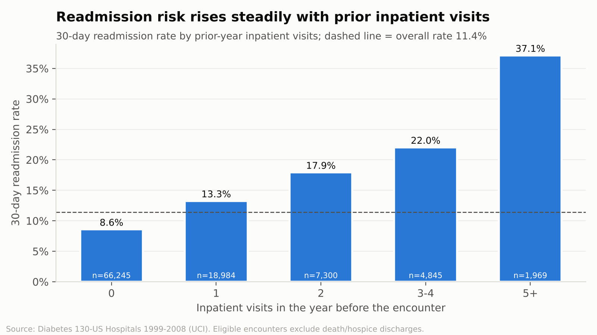
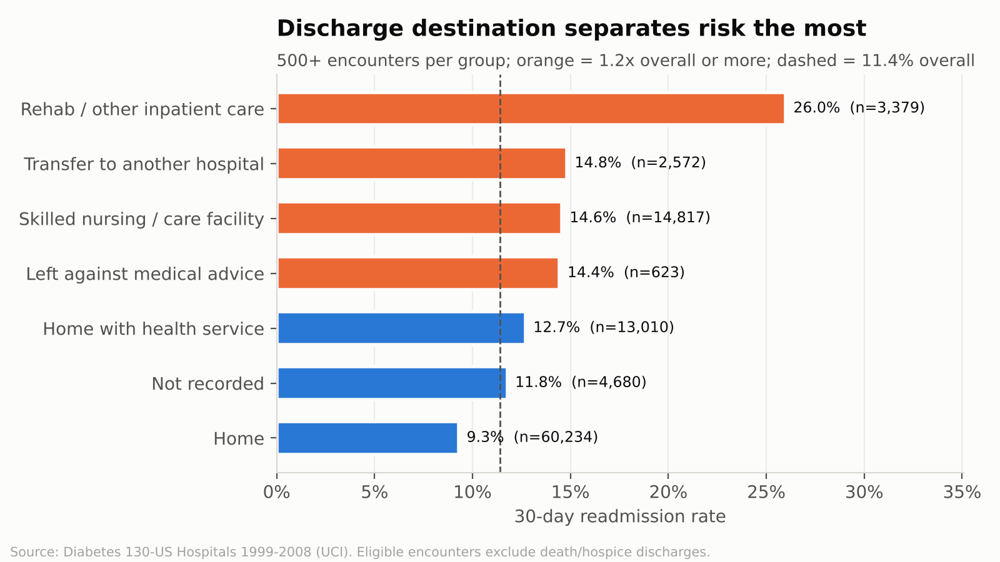
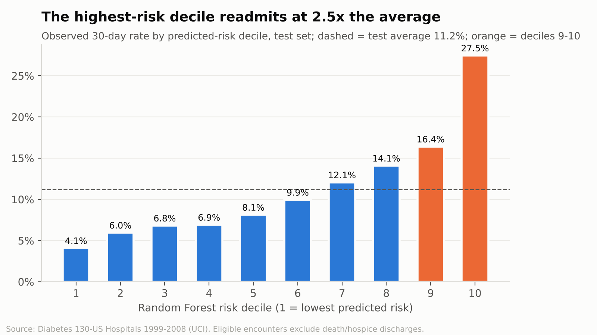
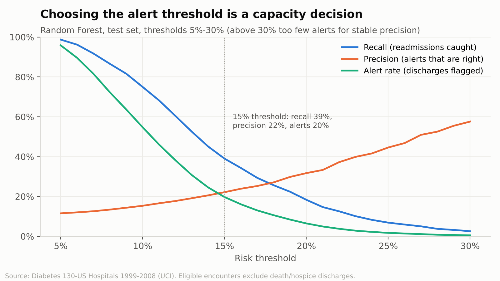

# Diabetes Readmission Risk: Finding the Patients Most Likely to Return Within 30 Days

A Power BI analytics project that examines 30-day hospital readmissions among diabetic patients, identifies the
patient and encounter characteristics linked to readmission, and turns a predictive risk score into a practical
alerting tool that hospital managers can tune to their own discharge-planning capacity.



---

## Project overview

When a patient with diabetes is readmitted shortly after discharge, the hospital carries the cost of a second stay,
beds are tied up, and the readmission often points to a gap in discharge planning or follow-up care. This project
looks at more than 100,000 inpatient encounters of diabetic patients to answer three management questions:

1. **How big is the problem and where is it concentrated?**
2. **Which patients and encounters carry the highest risk?**
3. **Can we flag high-risk patients at discharge, and what would that cost in workload?**

The answers are delivered as an eight-page Power BI report built as a native Power BI Project (`.pbip`), supported by
documented data preparation, statistical testing and two classification models.

## Business problem

A healthcare organisation wants to reduce avoidable readmissions among diabetic patients but does not know:

- what share of discharges come back within 30 days, and whether this varies by age, admission route or discharge destination;
- whether a patient's recent hospital use is a reliable early-warning sign;
- how hospital resources (length of stay, procedures, medications) are used across patient groups; and
- whether a data-driven risk score could direct limited follow-up resources to the right patients.

Without this, care-coordination programmes are either applied to everyone (expensive) or to patients chosen by
intuition (inconsistent). The report gives management a shared, evidence-based view of where to act.

## Project objectives

| # | Objective | Where it is answered |
|---|---|---|
| 1 | Examine the frequency of diabetes-related readmissions | Pages 1 and 2 |
| 2 | Identify characteristics associated with readmission | Pages 2 and 5 |
| 3 | Assess healthcare utilisation patterns | Page 4 |
| 4 | Investigate the link between previous hospital visits and readmission | Page 3 |
| 5 | Build and evaluate a readmission classification model | Pages 6 and 7 |
| 6 | Present findings to healthcare management | Whole report, analyst report, this README |

## Tools and technologies

| Tool | Role |
|---|---|
| **Power BI Desktop** (Power Query, DAX, PBIP/TMDL/PBIR) | Primary tool: data cleaning, star-schema model, 67 DAX measures, 8-page interactive report |
| Python (pandas, scikit-learn, statsmodels, SciPy, matplotlib) | Supporting tool: statistical tests, logistic regression and Random Forest, model validation. Power BI is not designed for training and validating classifiers, so models are trained in Python and their scores imported. |

## Dataset

- **Source:** *Diabetes 130-US Hospitals for Years 1999-2008* (Strack et al., 2014), UCI Machine Learning Repository.
  Public, de-identified research data. It is **not** data from a specific organisation; the business scenario is a
  realistic framing for portfolio purposes.
- **Scope:** 101,766 inpatient encounters, 71,518 patients, 130 US hospitals, 50 variables: demographics, admission
  and discharge details, diagnoses (ICD-9), lab tests, 23 diabetes medications, prior-year visits and readmission outcome.
- **Key considerations:** no admission dates (no trend analysis possible); weight is 97% missing; payer and specialty
  are 40-49% missing; 2,423 encounters ended in death or hospice and are excluded from readmission rates.

## Project workflow

1. **Data assessment** - profiled all 50 columns: missing-value markers ("?", "None"), constant columns, mixed-type
   diagnosis codes, coded IDs needing the IDS_mapping lookup, and repeat patients.
2. **Data cleaning (Power Query)** - standardised missing values, removed unusable columns, decoded IDs, grouped
   ICD-9 codes into clinical chapters, created bands and flags. Every step is logged in the
   [cleaning log](documentation/data_cleaning_log.md). Row count is unchanged: 101,766 in, 101,766 out.
3. **Data modelling** - star schema with one encounter fact, a medication child fact, five dimensions, model-output
   tables and two parameter tables. See [data model](documentation/data_model.md).
4. **DAX** - 67 measures, including eligibility-aware readmission rates, benchmark comparisons, conditional
   colour rules, dynamic text and a full confusion matrix that recalculates for any model and threshold.
5. **Statistical analysis and modelling (Python)** - chi-square and Mann-Whitney tests with effect sizes,
   adjusted odds ratios, logistic regression vs Random Forest with a patient-grouped train/test split and 5-fold
   grouped cross-validation.
6. **Validation** - every KPI recomputed in an independent pandas implementation; the DAX confusion-matrix rule
   checked against the Python threshold curve at every threshold; all 97 report files validated against
   Microsoft's PBIR schemas; the project opened in Power BI Desktop (October 2026) with all 8 pages rendering.
   Open QA items are listed in [qa_checklist.md](documentation/qa_checklist.md).
7. **Business interpretation** - each page carries the finding, the evidence and what it means for management.

## Key findings

**1. About 1 in 9 eligible discharges returns within 30 days.** The 30-day readmission rate is **11.4%**
(11,314 of 99,343 eligible encounters), and 47% are followed by a readmission at some point.

**2. Prior hospital use is the strongest warning sign.** The 30-day rate rises steadily from **8.6%** with no inpatient
stay in the previous year to **37%** with five or more. Each additional prior inpatient visit raises the odds of
readmission by about 31% after adjusting for other factors (OR 1.31, 95% CI 1.29-1.33).

**3. Where the patient goes after discharge matters more than who they are.** Patients transferred to rehab or other
inpatient care readmit at **26%** (2.3x the overall rate; adjusted OR 3.3), skilled-nursing and hospital transfers at
about 15%, while routine home discharges sit at 9.3%. By contrast, adult age bands, admission types and diagnosis
groups move the rate only between about 10% and 13%.



**4. Readmitted patients used more resources on their first stay**, slightly longer stays (4.8 vs 4.3 days) and more
medications (16.9 vs 15.9), but procedure counts show no link to readmission (p = 0.15). Utilisation describes
workload; it is a weak predictor on its own.

**5. A risk score helps prioritise, but it is not a crystal ball.** Random Forest reached a test ROC-AUC of **0.674**
(logistic regression 0.663; a simple "any prior inpatient visit" rule 0.602). Its value is in ranking: the highest
risk decile readmits at **27.5%**, 2.5x the average, while the lowest decile readmits at 4.1%.

**6. The default 0.5 cut-off is useless here.** With an 11% base rate, almost no patient scores above 50%, so the
model would raise no alerts. Flagging the top 20% of discharges (threshold about 15%) catches **39%** of readmissions,
with about one in five alerts being a true readmission. Page 7 lets managers explore this trade-off directly.





## Business recommendations

| Priority | Recommendation | Evidence |
|---|---|---|
| Immediate | Use **prior-year inpatient visits** as a simple screening flag at admission to start discharge planning early | Strongest single factor; available before discharge; no model needed |
| Immediate | Review handover processes for patients **discharged to rehab / other inpatient care and skilled nursing** | Highest readmission rates (15-26%) and largest adjusted odds ratios |
| Medium term | Pilot the risk score with a threshold set by **follow-up team capacity** (e.g. top 10-20% of discharges), and track outcomes | Risk deciles separate 4% to 27%; simulator quantifies alerts vs readmissions caught |
| Medium term | Improve recording of specialty, payer and HbA1c testing | 40-83% missing limits analysis |
| Longer term | Add social, follow-up appointment and post-discharge data, and recent (ICD-10) records, before using the model operationally | Current model AUC is moderate; data are 1999-2008 |

These recommendations rest on associations in observational data. Their impact should be measured in a pilot rather
than assumed.

## Report pages

| Page | Business question |
|---|---|
| 1 Executive Overview | How big is the problem and what are the headline drivers? |
| 2 Readmission Patterns | How does readmission vary by age, admission type, source and discharge? |
| 3 Prior Visits and Readmission | Does previous hospital use predict readmission? |
| 4 Healthcare Utilisation | How are length of stay, procedures and medications distributed? |
| 5 Risk Drivers | Which characteristics are associated with readmission, before and after adjustment? |
| 6 Predictive Model | How well do logistic regression and Random Forest perform? |
| 7 Alert Threshold Simulator | How many alerts, how many readmissions caught, how many false alarms? |
| 8 Data and Method Notes | Definitions, data notes and limitations |

## Deliverables

```text
diabetes-readmission-powerbi/
├── README.md
├── requirements.txt
├── analysis/
│   ├── Diabetes_Readmission_Analysis.pbip          # open this in Power BI Desktop
│   ├── Diabetes_Readmission_Analysis.SemanticModel/ # TMDL: tables, relationships, 67 DAX measures, M queries
│   ├── Diabetes_Readmission_Analysis.Report/        # PBIR: 8 pages, 86 visuals, custom theme
│   └── power_query/                                 # every M query as a standalone .m file
├── data/
│   ├── raw/diabetic_data.xlsx                       # original file, untouched
│   ├── processed/                                   # cleaned fact, medication and dimension tables (CSV)
│   └── model_outputs/                               # risk scores, metrics, curves, odds ratios, tests
├── scripts/                                         # Python: preparation, modelling, PBIP builders, validation
├── documentation/                                   # analyst report, cleaning log, data dictionary, DAX, M, model, KPIs
└── outputs/charts/                                  # analysis charts (Python, same data as the report)
```

### How to reproduce

1. `pip install -r requirements.txt`, then run `python scripts/00_export_raw_csv.py`,
   `01_reference_preparation.py`, `02_readmission_model.py`, `03_reporting_tables.py` and `04_analysis_charts.py`
   (about 10 minutes).
2. Open `analysis/Diabetes_Readmission_Analysis.pbip` in Power BI Desktop (2026 release or later; the PBIR report
   format does not open in older versions).
3. In *Transform data > Edit parameters*, set `DataFolder` to the full path of this repository's `data\` folder
   (ending with a backslash), then click *Refresh*.

The charts in this README are drawn in Python from the same processed data the Power BI model uses.

## Business value

The project shows how a hospital can move from "readmissions are too high" to specific, measurable actions: a
screening rule usable on day one, a short list of discharge pathways to review, and a risk-score pilot whose workload
is known in advance. It demonstrates the full analytics cycle: framing the business problem, preparing messy
healthcare data, modelling it properly in Power BI, testing what matters statistically, being honest about model
performance, and communicating trade-offs to managers.

## Limitations and assumptions

- **Observational data:** findings are associations, not causal effects.
- **Encounter-level analysis:** patients with several encounters contribute several rows; the model split is grouped
  by patient to prevent leakage.
- **No dates:** trends, seasonality and time-to-readmission cannot be analysed.
- **Outcome detail:** the data do not say whether a readmission was planned, preventable or diabetes-related.
- **Age of data:** 1999-2008 US hospitals using ICD-9; practice and coding have changed since.
- **Missing data:** weight (97%), HbA1c (83% not measured), specialty (49%) and payer (40%) limit some analyses.
- **Model performance:** ROC-AUC 0.67 is moderate. The score is suitable for prioritisation, not for individual
  clinical decisions.
- **Assumptions:** mapping codes with no description are grouped as "Not recorded"; death and hospice discharges
  are treated as not eligible for readmission.

## Conclusion

Readmission risk among diabetic patients is concentrated rather than evenly spread: it follows patients who have
been in hospital recently and those discharged to further institutional care. A Power BI report that makes these
patterns visible, and lets managers test how many alerts a risk score would generate, gives the organisation a
practical starting point for targeted care coordination.
