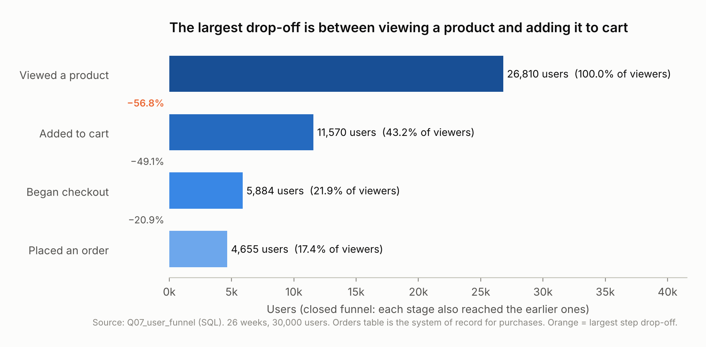
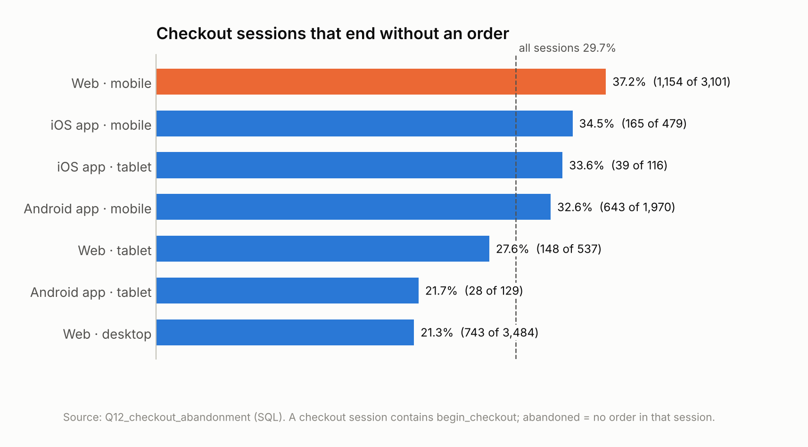
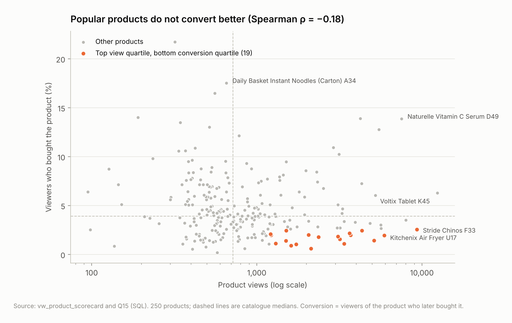
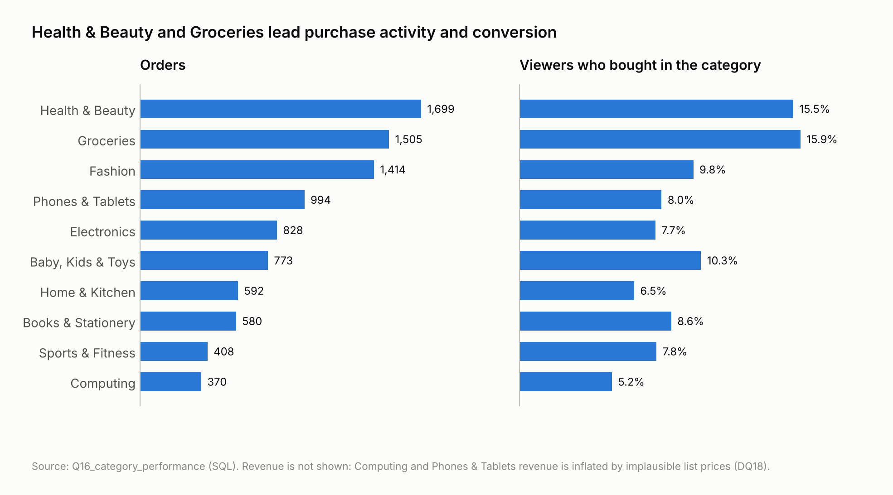
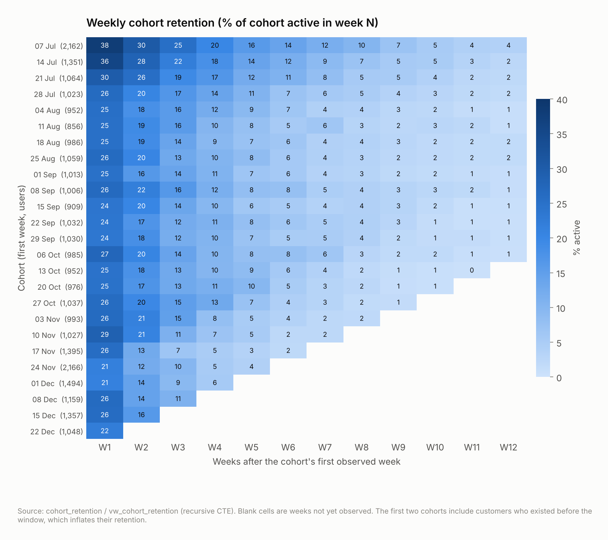
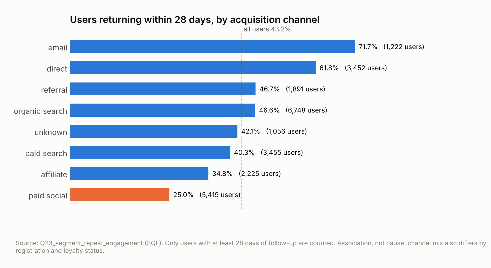
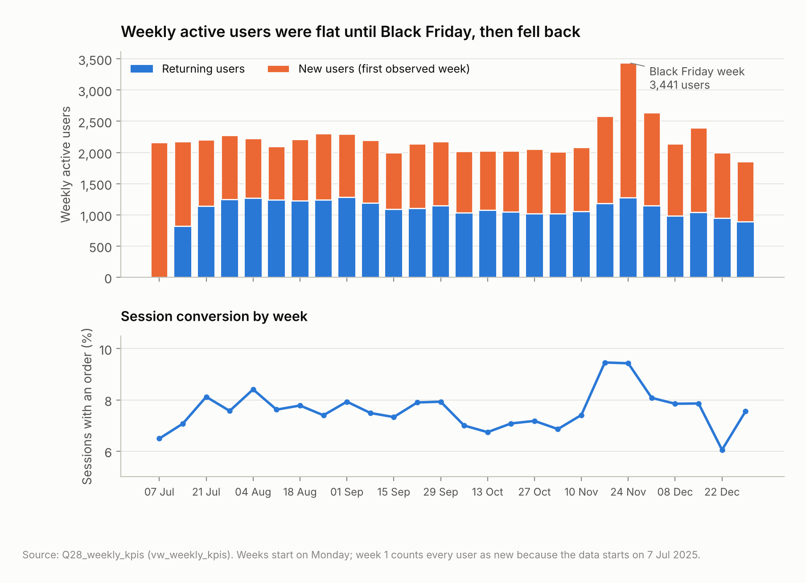

# Where Shoppers Drop Off: E-commerce Funnel, Product and Retention Analytics in SQL


## Project overview

An online marketplace records every page view, product view, cart action and checkout across its website and mobile apps. Its Product Manager could see traffic and orders but not the journey between them. This project turns 590,648 raw events into product metrics that show:

- how users engage;
- where they abandon their shopping journeys;
- which products and behaviours go with a purchase.

All of the work is done in SQL. One script builds a constrained database from the raw file, checks data quality, builds analysis tables, answers each business question, publishes reusable views and then validates itself.

## Business problem

Conversion problems are expensive to guess at. Without a measured funnel, a product team can spend a quarter redesigning checkout when most users never add anything to their cart. It can also promote best-sellers that attract views but convert poorly, or celebrate a promotion that brought in customers who never came back.

The analysis is built to support four decisions:

- which funnel stage to fix first;
- which products to promote or repair;
- which users and channels to invest in for retention;
- how to judge promotions.

## Project objectives

1. Measure user engagement with the platform.
2. Analyse the conversion funnel from product views to purchases.
3. Identify the stages at which users abandon their journeys.
4. Examine product and category performance.
5. Analyse returning-user behaviour and retention.
6. Identify opportunities to improve conversion and engagement.

## Tools and technologies

| Tool | Used for |
|---|---|
| **SQLite 3.45 (SQL)** | All data modelling, cleaning, analysis, views and validation. The dialect features used are CTEs (including recursive), window functions, FILTER and math functions |
| sqlite3 command-line shell | Running the full script end to end |
| Python 3 (standard library) | `run_sql_project.py`, a thin runner that executes the same SQL block by block and exports each result to CSV. No analysis is done in Python |
| Python (pandas, matplotlib) | Drawing the charts from the SQL result files |

## Dataset overview

The data is **synthetic**. It simulates a Nigerian online marketplace (an app called "OjaLoop", fictional brands, Nigerian cities) and does not come from a real company. It was supplied as one SQLite file with 10 tables:

| Table | Rows | Content |
|---|---:|---|
| events | 590,648 | page views, searches, product views, cart actions, checkouts, purchases |
| sessions | 89,557 | device, platform, traffic source |
| users | 30,000 | 10,586 registered, 19,414 guests |
| orders / order_items | 6,896 / 10,808 | status, payment, amounts |
| products / categories | 250 / 10 | catalogue and prices |
| promotions / promotion_products / calendar | 6 / 311 / 182 | promotions and the daily calendar |

It covers 26 weeks, from 7 July 2025 to 4 January 2026, including Black Friday and the festive season. Prices are in whole currency units; the currency is not stated, so Nigerian naira is assumed.

Three data issues shaped the method:

- **Tracking loss.** 3% of orders never appear as purchase events, so purchases are counted from the orders table.
- **Cross-session journeys.** 28% of orders finish a journey started in an earlier session, so the main funnel follows users rather than sessions.
- **Implausible prices.** 12 products have list prices far from their category norm (a wireless mouse at 241,000), so revenue rankings are treated as indicative.

Full details are in the [data dictionary](data/data_dictionary.md) and the [data-quality log](docs/data_quality_and_cleaning_log.md).

## Project workflow

```text
raw .sqlite (read-only) ─► staging + typed tables ─► data-quality register ─► derived tables ─► analysis ─► views ─► validation
                            PK/FK/CHECK, load audit    19 checks                sessions, users,   34 queries   8 views    27 checks
                                                                                cohorts, products
```

1. **Data assessment.**
   - The raw file is attached read-only.
   - Tables are loaded through primary-key, foreign-key and CHECK constraints, and events pass through a staging table with explicit type conversion.
   - A 19-check register records completeness, uniqueness, validity, consistency, integrity and timeliness.
2. **Cleaning and transformation.**
   - No rows are deleted; problem rows are flagged instead.
   - Derived tables summarise each session, user, user-week, cohort, cart addition, product and category.
   - Return rates and abandonment are made censoring-aware, so users and carts with too little follow-up are not counted as lost.
3. **Analysis.**
   - 34 queries answer the Product Manager's questions.
   - Techniques include multi-step CTEs, a recursive CTE for the cohort grid, and window functions (ROW_NUMBER, RANK, DENSE_RANK, NTILE, LAG, LEAD, running totals and moving averages).
   - Some statistics are also computed in SQL: medians, a Spearman rank correlation and Wilson confidence bounds.
4. **Views.** Daily and weekly KPIs, funnels, product and category scorecards, and cohort and segment retention, ready for a BI tool.
5. **Validation.**
   - 27 checks reconcile counts, totals and revenue across every layer and test business rules. All 27 pass.
   - A deliberately corrupted copy of the database made six of them fail, which shows the checks catch real errors.
6. **Business interpretation.** Each query carries a "Finding" comment with its tested result, and the report turns those findings into recommendations.

The build runs in about 35 seconds.

## Key analysis and findings

**1. The biggest leak is at the top of the funnel, not at checkout.** 56.8% of product viewers never add anything to their cart, against 20.9% of checkout users who don't order. Effort spent on product pages reaches the most users.



**2. Mobile-web checkout loses far more buyers than desktop.** 37.2% of mobile-web checkout sessions end without an order, against 21.3% on desktop. These users have already shown intent, which points to friction in the flow. Had mobile web completed checkouts at the desktop rate, about 490 more orders would have been placed over the 26 weeks, roughly 7% of all orders. That is a measure of the gap, not a forecast.



**3. Popular products do not convert better.** Views and conversion are weakly negatively related (Spearman ρ = −0.18). 75 products take 47% of all views but only 21% of units sold. A further 19 high-traffic products convert below their category, led by a pair of chinos with 9,337 views, 2.5% conversion and 87% cart abandonment. Merchandising attention can be reallocated.



**4. Everyday consumables drive purchase activity.** Health & Beauty and Groceries have the most orders, the highest viewer conversion (15.5% and 15.9%) and the lowest cart abandonment. Electronics and computing carry most of the revenue, but those figures are distorted by implausible list prices.



**5. Retention is decided in the first week.** 56% of users visit only once. Retention is 26.5% one week after the first visit and 11.0% four weeks after. Users who do come back mostly come back fast (median 4 days), so re-engagement has to happen in days 1–7.



**6. Channel quality differs sharply.** 72% of email-acquired users return within 28 days, against 25% from paid social. Paid social also converts at less than half the average rate. Loyalty members return far more (89%), but loyalty status is measured at extract date, so this may simply reflect that engaged users join.



**7. Black Friday doubled traffic, but its cohorts returned less.** Black Friday days averaged 864 sessions against 450, and conversion rose from 7.4% to 9.4%. Users acquired that week retained at about 5% by week 4, against 9–13% for earlier cohorts. Their week 4 falls in the December slowdown, so the two effects cannot be separated.



## Business recommendations

| When | Action | Why |
|---|---|---|
| Now | Fix purchase-event tracking and schedule the events-vs-orders reconciliation | 3% of orders are invisible to event-based reporting |
| Now | Audit mobile-web checkout; review the 19 high-traffic, low-converting product pages; correct the 12 implausible prices | Largest intent loss; misallocated traffic; distorted revenue |
| 1–3 months | A/B test the mobile checkout redesign, a persistent cart with "save for later", and cart reminders | 67.9% of cart additions are not bought within 7 days, and journeys span sessions |
| 1–3 months | First-week re-engagement for new users; replenishment reminders for consumables | Retention is decided in days 1–7, and consumables convert and repeat |
| 1–3 months | Judge paid social on downstream orders and retention, not traffic | Lowest add-to-cart, conversion and return rates |
| 3–12 months | Test registration and loyalty prompts with randomised experiments before scaling them; track promotion cohorts after each event | The current differences are associations, not proven effects |

Full reasoning, with evidence for each point: [insights and recommendations](docs/insights_and_recommendations.md).

## Deliverables

| Path | What it is |
|---|---|
| [`sql/ecommerce_product_analytics.sql`](sql/ecommerce_product_analytics.sql) | **The analysis.** About 2,000 lines of SQLite in 7 sections: setup, loading, data quality, cleaning, 34 analytical queries, 8 views, 27 validation checks. Every query is commented with its question, technique and tested finding |
| [`scripts/run_sql_project.py`](scripts/run_sql_project.py) | Runs the SQL file and exports every query result to CSV |
| [`scripts/make_charts.py`](scripts/make_charts.py) | Builds the charts from the exported results |
| `outputs/results/` | 41 CSV result files, one per query block (Q00 data-quality outputs, Q01–Q28 analysis, Q99 validation), and `_run_log.csv` with block timings |
| `outputs/figures/` | 9 charts, including a rendered sqlite3 shell output |
| `data/raw/ecommerce_clean.sqlite` | Source data (synthetic, unmodified, read-only) |
| `data/processed/` | The cleaned, analysis-ready data: `events_enriched.csv.gz` (all 590,648 events with derived fields), plus sessions, users, cart outcomes, product and category scorecards, cohort retention and the segment funnel as CSV |
| [`data/data_dictionary.md`](data/data_dictionary.md) | Source and derived tables, fields and definitions |
| [`docs/`](docs/) | Project brief with objective-to-query mapping, data-quality and cleaning log, KPI definitions, insights and recommendations, limitations, QA checklist, portfolio notes |
| `reports/` | Analyst technical report (DOCX and PDF) |

### Reproduce it

```bash
# from the repository root
sqlite3 data/processed/ecommerce_analytics.db < sql/ecommerce_product_analytics.sql > sqlite_output.txt   # plain SQL route (the shell prints every result)

# or, to also export every result to CSV and redraw the charts
pip install -r requirements.txt
python scripts/run_sql_project.py --fresh
python scripts/make_charts.py
```

The analysis database (about 280 MB) is a build artifact and is excluded from Git. The raw file is 66 MB: GitHub accepts it but warns above 50 MB, so Git LFS (`git lfs track "*.sqlite"`) is the tidier option.

## Business value

The project gives a product team a measured view of its funnel instead of opinions about it:

- **Where users drop off:** top of funnel first, then mobile-web checkout.
- **Which products waste traffic.**
- **When retention is won or lost:** the first week.
- **Which channels bring users who stay.**

The views can be connected straight to a BI tool, and the validation section can run on every refresh, so the same definitions keep working after this analysis. The opportunity sizes give the team a sense of scale for prioritisation without overstating what a change would deliver.

## Limitations and assumptions

- The data is synthetic; the findings demonstrate method, not facts about a real business.
- The analysis is observational. Differences between channels, devices, registration and loyalty groups are associations. Registration and loyalty are measured at extract date and may reflect engagement rather than cause it.
- Users active before 7 July 2025 look new in the first two weeks (left-censoring). Late users have less follow-up (right-censoring). Both are handled explicitly but limit the earliest and latest cohorts.
- Cart abandonment uses a 7-day window. 9.3% of orders come later than that, so some carts counted as abandoned are eventually bought.
- Revenue figures are affected by implausible list prices. The currency is assumed to be NGN, and there is no cost data.
- There are no page-level or checkout-step events, so the analysis shows where users drop off but not why.

Full detail: [limitations](docs/limitations.md).

## Conclusion

Using SQL alone, the project:

- built a tested, reproducible analytics layer from a raw event database;
- answered each of the Product Manager's questions with documented queries;
- showed where the business loses customers: before the cart, at mobile-web checkout and after the first week.

It shows end-to-end analytical practice: data modelling, data-quality control, advanced SQL, statistical care with censoring and small samples, and recommendations that are honest about what the data can and cannot show.
