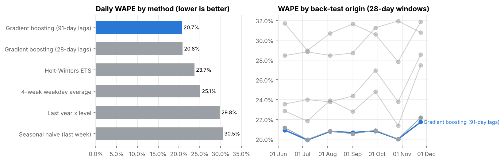
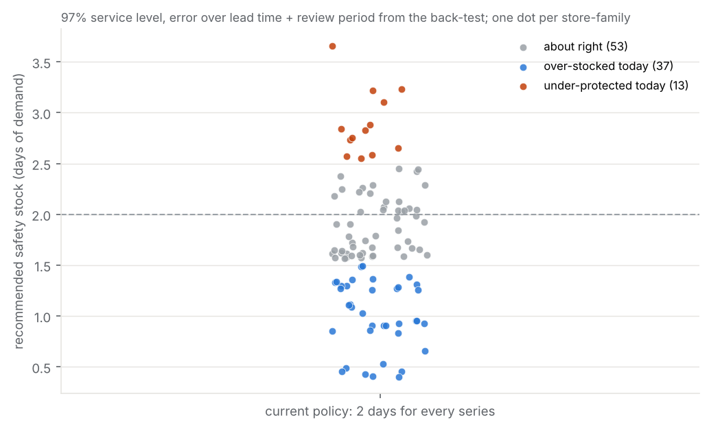
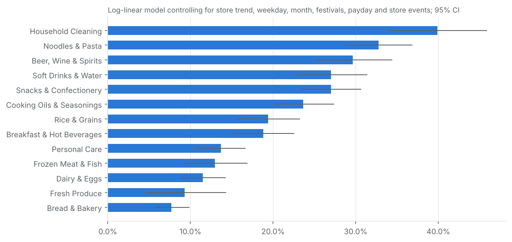
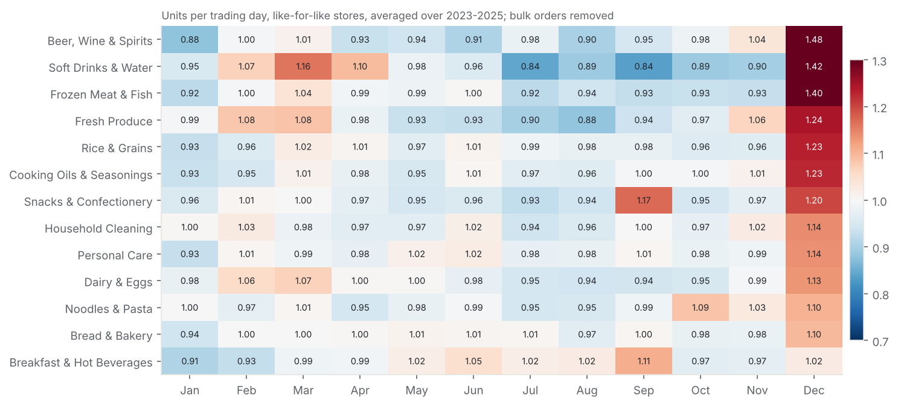

# Grocery Demand Planning: Forecasting Store Sales and Rethinking Safety Stock

**Can three years of daily sales tell a grocery chain how much to order, which promotions to run and where its supply chain is most at risk?** This project answers that question in Python for Basketline Supermarkets. It starts from a messy point-of-sale (POS) extract and ends with a validated forecast and a replenishment policy for each store and product family.

> **About the data.** Basketline Supermarkets is a fictional company and the dataset is synthetic, built for analytical practice. No record represents a real retailer, customer or transaction, and the findings describe the simulated business, not real grocery markets.

---

## Project overview

Basketline runs eight grocery stores in Lagos, Abuja, Port Harcourt, Ibadan and Kano, in three formats: hypermarket, supermarket and express. Demand has been hard to predict. Planning relies on rules of thumb, promotions are judged on gut feel, and every store holds the same two days of safety stock for every product family. The result is shelf gaps in some places and excess stock (including perishables) in others.

The analysis covers **104,000 store-family-days of sales** from January 2023 to December 2025 (8 stores, 13 product families). It describes how demand behaves, measures what promotions really add, compares six forecasting methods in an honest back-test, and turns the best forecast into store-level ordering rules.

## Business problem

Management needs answers to four practical questions:
1. **Demand patterns:** where, when and how much demand varies, by store, category, weekday, month and festival.
2. **Promotions:** whether they work, for which products and in which stores, and why some appear to fail.
3. **Forecasting:** whether sales can be forecast reliably enough to plan purchasing, and with which method.
4. **Replenishment:** how much stock each store needs to carry to hit a 97% service level without tying up cash or wasting perishables.

## Objectives

1. Analyse historical product sales across retail stores.
2. Identify seasonal patterns and demand fluctuations.
3. Assess the relationship between promotions and sales performance.
4. Compare demand across stores and product categories.
5. Develop a forecasting model for future sales.
6. Translate forecasts into actionable demand-planning recommendations.

## Tools

- **Python:** pandas, NumPy, SciPy, statsmodels (OLS, STL decomposition, Holt-Winters), scikit-learn (gradient boosting, permutation importance) and Matplotlib.
- **Jupyter Notebook:** the full workflow runs end to end in about 3 minutes.

## Dataset

The source is a single Excel workbook (`data/raw/`) containing:
- **Daily POS sales feed:** 104,833 raw rows of units, naira sales, promotion flag and stock-out flag.
- **Stores:** city, region, format, size and opening date.
- **Product families:** category and shelf life.
- **Promotion calendar:** 127 completed promotions plus 8 planned for Q1 2026, with store participation.
- **Daily calendar:** Nigerian holidays, Ramadan, payday and school periods.
- **Store events:** an opening, a refurbishment, a competitor opening and till outages.
- **Replenishment settings:** lead times, review periods, case packs and current safety-stock rules.

**Considerations:**
- **Data quality:** the raw feed has real problems: mixed date formats, inconsistent labels, duplicate and superseded loads, a test till, sign errors, missing values and one store-month recorded in kobo instead of naira.
- **Missing days:** sales are missing on closure and outage days, which must not be treated as zero demand.
- **Censored demand:** stock-out days understate true demand.

## Workflow

| Stage | What was done |
|---|---|
| **Data assessment** | Profiled every column, reference table and key; listed issues before touching the data |
| **Cleaning** | 12 logged cleaning rules applied to the raw feed. The result matches the provider's cleaned table on 100% of rows, as an independent check |
| **Transformation** | Built a complete daily panel (103 series x 1,096 days) with a reason for every missing day; added calendar, festival and promotion features; a two-tier rule separates bulk B2B orders from shelf demand |
| **Analysis** | Weekday, payday and monthly indices with significance tests; STL decomposition; festive event studies; volatility around expected demand; per-family regression to isolate promotion effects; uplift and diagnosis for every promotion-store event |
| **Forecasting** | Rolling-origin back-test (7 origins x 28 days) of 6 methods, from naive rules to Holt-Winters and a global gradient-boosting model with leak-free lag features; forecast for Q1 2026 |
| **Planning** | Safety stock from the back-test's cumulative error over each series' lead time + review period; order-up-to levels in full cases; comparison with the current 2-day rule |
| **Validation** | 12 automated QA checks (reconciliations, leakage, completeness) |

## Key findings

**1. Sales are growing in naira, not in volume.** For stores open throughout, naira sales rose 80% from 2023 to 2025 while units fell 2.3%. Average prices rose about 35% a year, so the business has to plan in units.

**2. Demand follows a strong calendar, and it differs by store type and region.**
- **Weekday:** Saturday is 42% above average in hypermarkets, but the express store peaks on Friday and is quiet on Sunday.
- **Payday:** staples such as household cleaning and rice sell 16-18% more in the month-end salary window than mid-month.
- **Christmas:** the final week before Christmas lifts frozen meat to 2.7x its normal level and beer and soft drinks to 2.3x.
- **Eid and Ramadan:** Eid lifts Kano by 1.6x, against 1.1-1.2x elsewhere.

**3. Volatility belongs to the store-product combination.** Bread is stable everywhere (CV about 0.17). Fresh produce, frozen and beer in Port Harcourt are the most volatile series in the chain. One stock rule cannot fit both.

**4. Promotions work, but unevenly.** After controlling for season, festivals and store trends:
- **By family:** promotions lift household cleaning by 40% and noodles by 33%, but bread and fresh produce by only 8-9%.
- **By mechanic:** multibuy offers deliver a median uplift of 1.36, against 1.16 for straight price cuts. In-store displays with no discount achieve almost as much as price cuts (1.14).
- **By store:** Ibadan's typical uplift (28%) is more than double that of Lekki or the express store (11%).

**5. 15% of promotions coincided with lower sales, and most of these are explainable:**
- January timing after the December peak (33 events);
- stock-outs during the promotion (8);
- four cases where the shelf price never actually changed, all in the same two stores.

**6. Sales can be forecast well.**
- **Accuracy:** a global gradient-boosting model reaches a daily WAPE of 20.7% and a weekly WAPE of 9.9%.
- **Against current practice:** the store-manager rule of thumb (average of the last four same weekdays) scores 25.1% and 14.1%.
- **Horizon:** a version using only 91-day-old data is just as accurate, so one model can plan a full quarter ahead.

**7. Better forecasts mean less, and better-placed, safety stock.**
- **Total:** the recommended policy holds 20% less safety stock than today's flat rule. It is 42% lower than the same service level would need with the rule-of-thumb forecast.
- **Bread, dairy and fresh produce:** need only 0.5-1 day of cover, against today's 2 days.
- **Port Harcourt and Kano:** 13 series need more cover (up to 3.7 days) because of 5-7-day lead times.

## Recommendations

| Priority | Action |
|---|---|
| **Now** | Replace the flat 2-day safety stock with the series-level levels in `outputs/results/replenishment_policy_by_series.csv` |
| **Now** | Order from the Q1 2026 forecast; track WAPE and bias weekly; re-train monthly |
| **Now** | Add a promotion launch check: confirm the shelf price changed and build stock first in long-lead stores |
| **Next quarter** | Shift promotion spend to responsive families (household, noodles, drinks, snacks) and to multibuy and display mechanics; stop deep discounts on bread and fresh produce |
| **Next quarter** | Make promotions store-specific, and plan festive and payday build-ups by region |
| **Longer term** | Shorten lead times and improve supply reliability in Port Harcourt and Kano; capture inventory, lost-sales, SKU and margin data to move from volume to profit optimisation |

## Repository contents

```text
basketline-grocery-demand-forecasting/
|-- README.md
|-- requirements.txt
|-- data/
|   |-- processed/basketline_sales_daily_clean.csv     # cleaned, analysis-ready daily sales
|   |-- processed/cleaning_log.csv                     # every cleaning action with row counts
|   |-- processed/family_label_mapping.csv             # audit trail for label standardisation
|   `-- data_dictionary.md
|-- notebooks/
|   `-- basketline_demand_planning_analysis.ipynb      # the full analysis, executed
|-- outputs/
|   |-- charts/                                        # 17 charts used in the analysis
|   `-- results/                                       # forecast, back-test, promotion and policy tables
`-- documentation/
    |-- analyst_report.docx / .pdf                     # technical report
    |-- data_cleaning_log.md
    |-- kpi_definitions.md
```

Key result files in `outputs/results/`:

| File | Contents |
|---|---|
| `forecast_q1_2026.csv` | Daily forecast with a p10-p90 range for every store and family |
| `backtest_predictions.csv.gz` | Every back-test prediction from all six methods |
| `promotion_event_results.csv` | Uplift and diagnosis for each of the 768 promotion-store events |
| `promotions_with_lower_sales.csv` | The low-sales cases and their likely causes |
| `replenishment_policy_by_series.csv` | Safety stock and order-up-to level for each of the 103 series |
| `volatility_by_series.csv` | Volatility measure and class for each series |
| `key_metrics.json` | Headline figures used in the reports |

**To reproduce:**

```bash
pip install -r requirements.txt
jupyter nbconvert --to notebook --execute --inplace notebooks/basketline_demand_planning_analysis.ipynb
```

## Visual highlights

| | |
|---|---|
|  |  |
|  |  |

## Business value

The project replaces rules of thumb with evidence a buying team can use on Monday morning. It provides:
- **an order-ready forecast** with known accuracy;
- **a safety-stock policy** that frees stock where demand is stable and protects it where supply is slow;
- **a promotion playbook** showing which products, mechanics and stores give real uplift;
- **a short list of operational failures to fix:** promotions launched without stock, and discounts not applied at the shelf.

## Limitations

- **Synthetic, family-level data:** the data is synthetic and at product-family level, not SKU level.
- **Censored demand:** stock-out days understate demand, and the size of lost sales is not recorded.
- **Promotion effects are associations, not proof:** they are estimated from observational data and controlled for the calendar drivers that were measured, but promotions were not randomised.
- **No cost or inventory data:** without costs, margins or inventory positions, the recommendations are expressed in units and service level rather than profit.
- **Assumption behind safety stock:** the safety-stock levels assume Q1 2026 forecast errors will resemble those seen in the 2025 back-test.

## Conclusion

The project shows that the business's demand can be described, forecast and planned against with a single, reproducible Python workflow. It connects data cleaning, statistical analysis and machine-learning forecasting to concrete decisions on what to order, how much stock to hold and which promotions to run.
