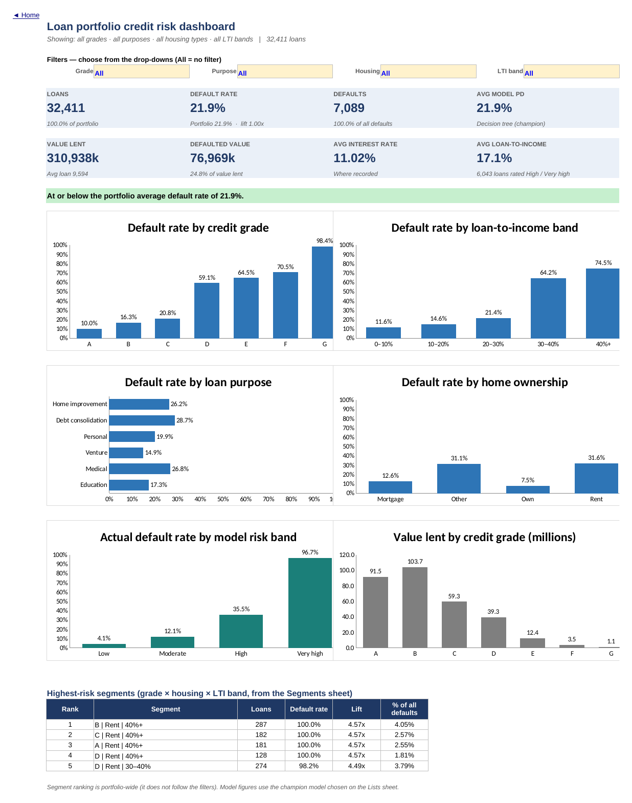
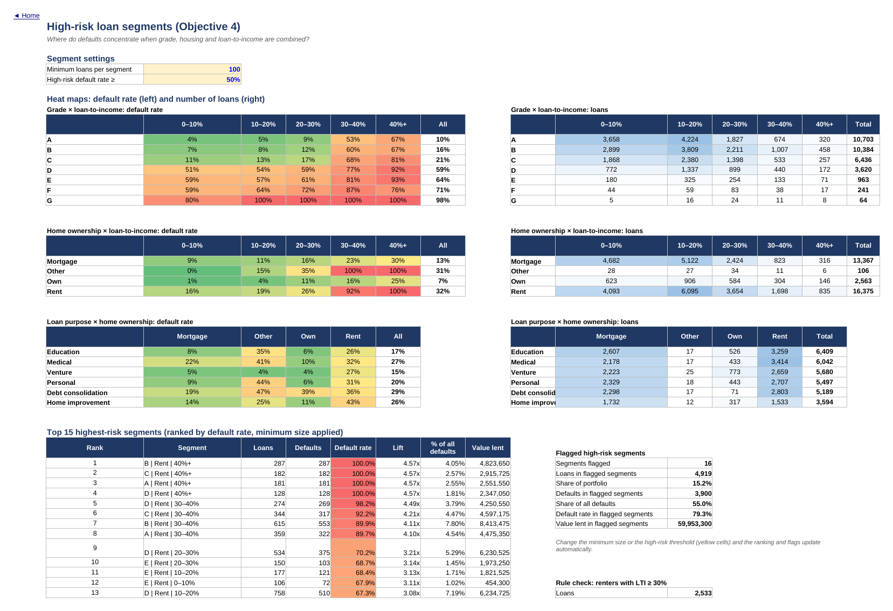
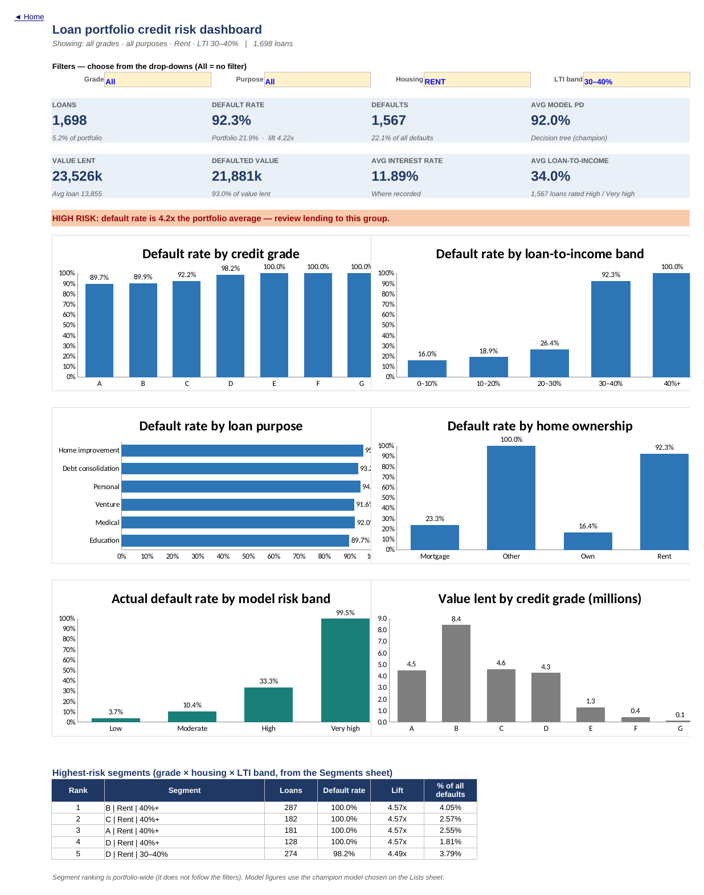
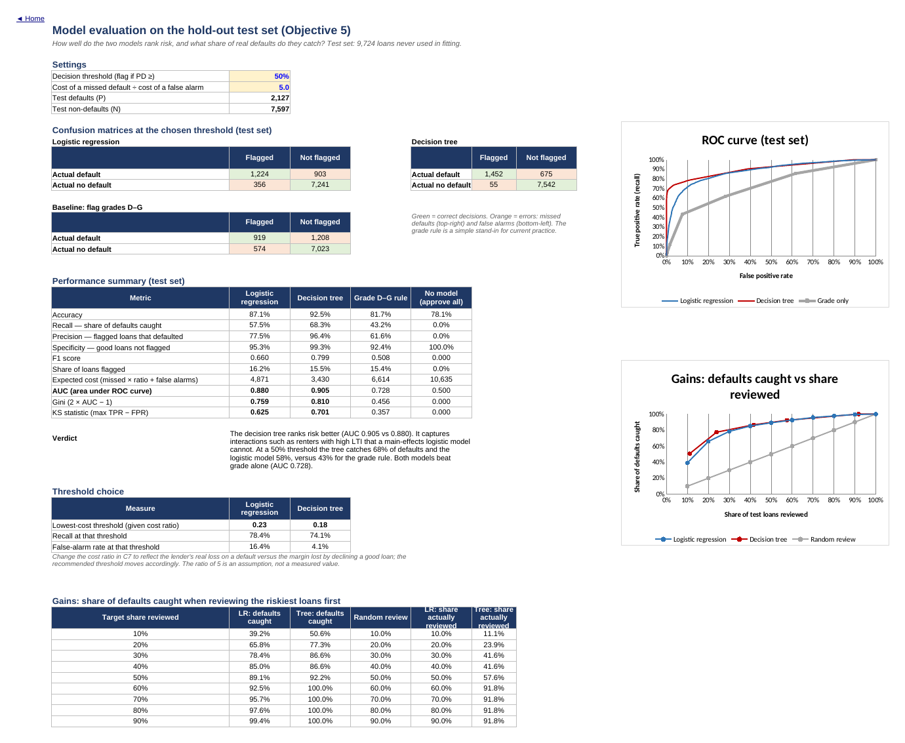

# Loan Portfolio Credit Risk Analysis & Default Monitoring Tool (Excel)

An end-to-end credit risk project built in Microsoft Excel: a 32,000-loan portfolio is cleaned, profiled and tested for default drivers; high-risk segments are ranked; two predictive models are built and evaluated on unseen data; and everything is packaged into an interactive monitoring workbook that a credit team could use day to day.



---

## Project overview

A lending institution wants a clearer view of the risk sitting in its loan book. It has historical application data, borrower profiles and repayment outcomes, but no structured way to answer basic questions: how risky is the portfolio overall, which kinds of borrowers and loans default, where risk is concentrated, and whether defaults could be flagged before a loan is approved.

This project answers those questions and turns the answers into a working tool. The workbook combines a filterable dashboard, statistical evidence for each risk driver, a ranked list of high-risk segments, a logistic regression and a decision tree implemented as live Excel formulas, a test-set model comparison, and an applicant scorer.

## Business problem

Roughly one in five loans in the book defaulted, yet management lacked:

- a reliable picture of how risk is distributed across grades, purposes and borrower types;
- evidence on which application characteristics actually go with default, and how strongly;
- a way to identify specific segments where lending should be tightened; and
- a forward-looking estimate of default risk for new applications.

Without these, the loan grade is the only ready-made risk signal — and, as this analysis shows, grade alone misses much of the risk that application data can reveal. The project is designed to support decisions on lending limits, approval rules, review routing and ongoing risk monitoring.

## Objectives

1. Assess the overall performance and risk profile of the loan portfolio.
2. Identify customer and loan characteristics associated with default.
3. Evaluate how loan grades and interest rates relate to default rates.
4. Identify high-risk loan segments.
5. Develop a predictive model to estimate the likelihood of default, and compare a logistic regression with a tree-based model.
6. Translate the findings into recommendations for credit-risk monitoring.

## Tools and technologies

| Tool | What it was used for |
|---|---|
| **Microsoft Excel** (primary) | Structured tables and structured references; `COUNTIFS` / `SUMIFS` / `AVERAGEIFS` / `MINIFS` / `MAXIFS`; `INDEX`–`MATCH`; array formulas; `SUMPRODUCT`; statistical functions (`CHISQ.DIST.RT`, `T.DIST.2T`, `NORM.S.DIST`, `STDEV.P`); data validation drop-downs; conditional formatting (heat maps, alerts, data bars); defined names; charts; Solver-ready log-likelihood |
| **Python** (supporting) | pandas to apply the documented cleaning rules reproducibly; statsmodels and scikit-learn to estimate the model parameters, which Excel cannot fit natively. The fitted parameters are then implemented and evaluated entirely in Excel formulas |
| **Power Query (M)** | An equivalent cleaning script, provided so the preparation can be refreshed inside Excel (written to mirror the pandas rules; not yet run in Excel) |

## Dataset

- **Source:** `credit_risk_dataset.csv`, supplied for the project — 32,581 loans and 12 fields covering borrower age, income, home ownership and employment length; loan purpose, grade, amount, interest rate and loan-to-income; credit-bureau history; and the repayment outcome (`loan_status`, 1 = default).
- **Nature of the data:** the file has no documentation, IDs or dates and matches a widely circulated public practice dataset. It is **not** the records of a real lender. Some patterns in it are near-deterministic (for example, almost every renter who borrowed more than 30% of their income defaulted), which suggests it may be partly rule-generated. Results should be read as a demonstration of method, not as evidence about real borrowers.
- **Scope:** a single snapshot with no application dates, so trends over time cannot be analysed. Currency is not documented.

## Project workflow

1. **Data assessment** — profiled every field, checked completeness, validity, uniqueness and internal consistency.
2. **Data cleaning** — removed 165 exact duplicates (second copies sat in two contiguous file blocks, pointing to an overlapping extract) and 5 records with impossible ages; set 2 impossible employment lengths and 11 placeholder interest rates to missing; kept and flagged missing values instead of deleting them. 32,581 → **32,411 loans**, every exclusion logged.
3. **Integrity investigation** — found that the supplied loan-to-income field disagrees with loan ÷ income in 428 records, *all of them defaults*. Recomputed the ratio, flagged the records and showed the conclusions are unchanged either way.
4. **Transformation** — built 19 formula columns in the Excel table: loan-to-income, ln(income), seven analysis bands, model inputs, model scores and a risk band. New rows added to the table are banded and scored automatically.
5. **Analysis** — portfolio profiling; chi-square tests with Cramér's V and Welch t-tests for every driver; within-grade pricing analysis; Weight of Evidence / Information Value; heat maps and a ranked segment table across 140 grade × housing × loan-to-income combinations.
6. **Modelling** — logistic regression (with variable selection and a linearity check) and a depth-limited decision tree tuned by 5-fold cross-validation, both trained on a stratified 70% sample and evaluated on a 30% hold-out.
7. **Reporting** — dashboard, findings sheet with live evidence, applicant scorer.
8. **Validation** — a QA sheet with 28 reconciliation checks (all pass), plus every KPI, test statistic and all 32,411 model scores reconciled against independent Python calculations.

## Key findings

**1. Roughly one loan in five defaults.** 7,089 of 32,411 loans defaulted (21.9%). Defaulted loans account for 77.0m of the 310.9m lent (24.8% by value), because larger loans default more often.

**2. Loan-to-income is the strongest single risk driver.** Default climbs from 11.6% below 10% of income to 21.4% at 20–30%, then jumps to 64.2% at 30–40% and 74.5% above 40%. Its association with default (Cramér's V = 0.43) is the strongest of the eleven characteristics tested. The jump at 30% is the most useful threshold in the data for setting policy.

**3. Renters borrowing 30% or more of their income are the clearest high-risk group.** These 2,533 loans are 7.8% of the book but 33.9% of all defaults, with a 94.8% default rate. Non-renters at the same loan-to-income defaulted at 24.2%. Sixteen segments (grade × housing × LTI, at least 100 loans each) default at 50% or more; together they hold 15.2% of loans and 55.0% of all defaults.



Filtering the dashboard to this group shows the tool doing its job — 1,698 renters at 30–40% LTI, a 92.3% default rate and an automatic HIGH RISK alert:



**4. Risk jumps sharply between grades C and D.** Grades A–C default at 10–21%; grade D jumps to 59%, rising to 98% in grade G. Grades D–G are 15.1% of loans. The prior-default flag appears only in grades C–G, so the grade already encodes credit history.

**5. Interest rate mirrors grade and adds little on its own.** Defaulters paid 2.6 percentage points more on average, but within each grade, loans priced above the grade's median rate default at about the same rate as those priced below it (grade C: 20.8% vs 20.8%; grade D: 60.0% vs 59.0%). Rate is a consequence of the grade, not an independent risk signal — which is why it dropped out of the logistic model.

**6. Income, housing and employment matter; age and credit-history length do not.** Borrowers earning under 25k default at 54.6% versus 8.4% above 120k. Renters default at 31.6% versus 12.6% for mortgage holders and 7.5% for owners. Default falls steadily with employment length (28.0% under one year to 16.2% over ten), and borrowers with *unknown* employment length default at 31.7% — missing data is itself a warning sign. Age and credit-history length show negligible association (Cramér's V ≈ 0.03).

**7. Default can be predicted well from application data — and much better than by grade alone.**

| Test set (9,724 loans) | Logistic regression | Decision tree | Grade D–G rule |
|---|---|---|---|
| AUC | 0.880 | **0.905** | 0.728 |
| Defaults caught at a 50% threshold (recall) | 57.5% | **68.3%** | 43.2% |
| Flagged loans that did default (precision) | 77.5% | **96.4%** | 61.6% |

The decision tree wins because the risk is driven by *interactions* — a high loan-to-income ratio is far more dangerous for a renter than for a homeowner — which a main-effects logistic model cannot capture. At the lowest-cost threshold (assuming a missed default costs five times a false alarm) the tree catches 74% of defaults while flagging only 4% of good loans. Its "Very high" risk band holds 4,992 loans with a 96.7% actual default rate; its "Low" band holds 16,243 loans at 4.1%.



**Most useful predictors:** loan-to-income, grade, housing and income (Information Value 0.91, 0.86, 0.38 and 0.51 respectively; together they account for 85% of the decision tree's variable importance). Interest rate also scores highly on its own (IV 0.66) but adds nothing once grade is known.

## Business recommendations

| Priority | Recommendation | Evidence |
|---|---|---|
| Immediate | Introduce a loan-to-income limit: 30%+ goes to manual review; above 40% requires a lower amount or extra security | Default jumps from 21% to 64% at the 30% threshold |
| Immediate | Treat "renter + LTI ≥ 30%" as a hard policy rule and track its share of new lending as a key risk indicator | 94.8% default rate; one-third of all defaults |
| Immediate | Make employment length a mandatory, verified field | Unknown employment defaults at 31.7% |
| Medium term | Review pricing and approval limits for grades D–G and recalibrate grade boundaries | 59–98% default rates in D–G |
| Medium term | Pilot the decision-tree score as a second-line check: route High / Very high applications to senior review | AUC 0.905 vs 0.728 for grade alone |
| Medium term | Agree the real cost of a missed default vs a declined good loan with Finance, then set the model threshold | Threshold tool in the workbook |
| Long term | Capture origination dates, loan IDs, balances at default, recoveries and a written default definition; fix the LTI calculation at source | Needed for trend, vintage and expected-loss monitoring |

## Deliverables

```text
credit-risk-portfolio-analysis/
├── README.md
├── requirements.txt
├── analysis/
│   └── Credit_Risk_Monitoring_Tool.xlsx      ← the Excel tool (21 sheets)
├── data/
│   ├── raw/credit_risk_dataset.csv           ← untouched source file
│   ├── processed/credit_risk_clean.csv       ← 32,411 cleaned loans + derived fields + train/test flag
│   ├── processed/excluded_records.csv        ← 170 excluded records with reasons
│   └── data_dictionary.md
├── documentation/
│   ├── Credit_Risk_Analyst_Report.docx / .pdf
│   ├── data_cleaning_log.md
│   ├── kpi_definitions.md
│   ├── excel_user_guide.md
│   ├── power_query_cleaning.m
│   └── portfolio_positioning.md
├── outputs/
│   ├── dashboard/                             ← dashboard (unfiltered and filtered) and Home sheet exports
│   ├── charts/                                ← sheet exports used above
│   └── model/model_parameters.json            ← fitted coefficients, tree structure, CV results
└── scripts/
    └── prepare_data_and_fit_models.py         ← cleaning rules + parameter estimation
```

**Inside the workbook**

| Sheet | Purpose |
|---|---|
| Dashboard | Four drop-down filters drive eight KPI cards, a risk alert and six charts |
| Insights | Ten findings with live evidence, actions and timeframes, plus monitoring indicators |
| Portfolio · Risk_Drivers · Grade_Rate · Segments | Objectives 1–4, with tests and effect sizes |
| Predictive_Power | Weight of Evidence and Information Value for every variable |
| Model_LR · Model_Tree · Model_Eval | Objective 5: coefficients and odds ratios, 32 tree rules, confusion matrices, ROC, gains, calibration, threshold choice |
| Scorer | Scores a new application with both models and shows similar historical loans |
| QA_Checks | 28 reconciliation checks |
| Data_Clean · Data_Raw · Data_Exclusions | Cleaned table (with formula columns), raw data and exclusions |
| Cleaning_Log · Data_Dictionary · KPI_Definitions · Lists | Documentation, settings and band thresholds |

The images in this README are page exports of the workbook rendered with LibreOffice Calc, so fonts and chart styling differ slightly from how the file looks in Excel.

To reproduce the preparation and model estimation: `pip install -r requirements.txt` then `python scripts/prepare_data_and_fit_models.py` from the repository root.

## Business value

The workbook replaces one-off analysis with a reusable monitoring tool. A credit manager can filter to any part of the book and immediately see whether it is above risk tolerance; risk analysts can see which segments to tighten and by how much; and underwriters can score an application and see the outcome of similar past loans. The analysis also makes a concrete case that a simple loan-to-income rule, combined with housing status, would have flagged a third of all defaults while touching under 8% of lending.

## Limitations and assumptions

- **Data provenance:** the dataset appears to be a public practice dataset with some rule-like patterns, so model accuracy is likely higher than it would be on real applications.
- **No dates:** no trend, seasonality or vintage analysis, and no out-of-time validation — the models were validated on a random 30% hold-out only.
- **Undocumented definitions:** the meaning of default, the observation window and the currency are unknown; `loan_status = 1` is assumed to mean default.
- **No loss data:** exposure is the original loan amount; balances at default and recoveries are not available, so expected loss cannot be estimated.
- **Approved loans only:** the data contains only loans that were granted, so models learn nothing about rejected applicants (no reject inference).
- **Missing values:** 9.6% of interest rates and 2.7% of employment lengths are missing; they are kept as explicit categories, with median imputation used only as a tree input.
- **Associations, not causes:** characteristics such as renting or high loan-to-income identify risk; they do not prove it.
- **Model scope:** the Excel-native models were chosen for transparency. A gradient-boosted model reached a test AUC of 0.944 in Python as a benchmark, showing there is extra accuracy available on a platform that can govern a more complex model.

## Conclusion

The portfolio's risk is concentrated and identifiable: loan-to-income and housing status, on top of grade, separate borrowers who almost always repay from those who almost always default. The project shows how that insight can be found with sound statistics, validated carefully, and delivered as a practical Excel tool that supports better lending decisions and ongoing credit-risk monitoring.
